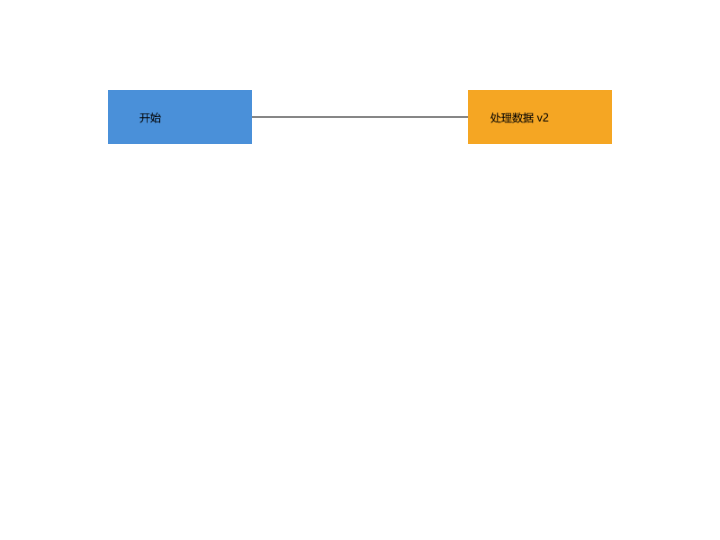

# Lab1 SVG 编辑器（CLI）

高级软件开发技术课程 Phase 1 作业。TypeScript 面向对象实现，包含六种图形、19 种命令、Command 撤销重做、Composite 容器、SVG 文件读写。

[GitHub 仓库](https://github.com/NuoJin1229/svg_editor_lab1) · [实验报告](./doc/README.md) · [验收记录](./doc/acceptance.md)

## 安装与启动

需要 Node.js 22 或更高版本及 npm。以下命令在本仓库根目录 `svg_editor/` 执行，依赖安装到本项目。

```text
npm ci
npm run cli
```

CLI 显示 `svg>`，输入 init 或 read 建立文档，之后用 help 查看全部命令。EOF 退出，Windows 可按 Ctrl+Z 后回车。

```text
init 800 600
create g node
create rect box 120 100 160 60 #4a90d9 in node
create text title 145 135 "开始" in node
move node 20 30
undo
tree
save my-diagram.svg
```

SVG 可直接用浏览器打开。save 成功后建立历史屏障，下一条成功编辑重新启用撤销。错误不改变文档与历史。

## 构建与验证

```text
npm run typecheck
npm run build
npm test
npm run check:architecture
```

`npm run verify` 汇总执行上述检查。构建后还可用 `node dist/main.js` 启动。

本次最终验证为 67/67 测试通过，包含真实 CLI 进程、课程会话、失败回滚、SVG 往返和渲染像素检查。[验证日志](./doc/evidence/verification.txt)

## 重现样例与渲染

```text
npm run examples
npm run render -- examples/flowchart.svg examples/flowchart.png
npm run render -- examples/flowchart-moved.svg examples/flowchart-moved.png
```

examples 脚本回放四个会话，生成示例 SVG 与 `doc/evidence/` 输出记录，会替换同名演示产物。恢复会话和典型会话包含用于验收的预期错误，脚本核对错误数量。



- [典型会话输入](./examples/typical.commands)
- [版本 A 输入](./examples/flowchart.commands)
- [恢复会话输入](./examples/recovery.commands)
- [移动会话输入](./examples/moved.commands)
- [版本 A SVG](./examples/flowchart.svg)

## 支持范围

支持 rect、circle、ellipse、line、text、g 和课程规定属性，包含嵌套、ID 补全、UTF-8 中文与 XML 转义。box 是后续插件阶段的类型，当前返回未知类型错误，图形 ID 可以使用 box。

外部 SVG 的 transform、CSS、path、use、渐变、字体排版属性和非标准 viewBox 等超出当前导入子集，会明确报错。详细兼容边界及未明确行为的项目约定见实验报告。
