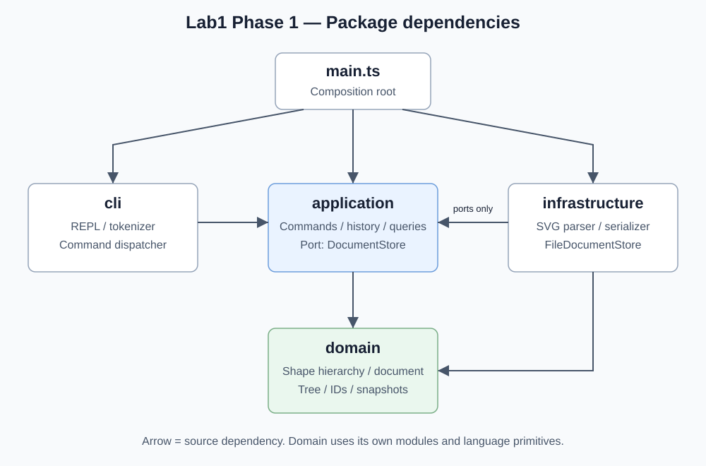

# Lab1 Phase 1 SVG 编辑器（CLI）实验报告

> 2026-11-02 实现与验收。课程依据为工作区中的 `lab1文档.md`，冲突时以课程要求为准。标为“项目约定”的内容是对未明确行为的补充。实现、测试、源码检查和实际渲染分别保留证据。

实际工程根目录为 `svg_editor/`，本文位于课程指定的 `doc/README.md`。原始开发从 `321cf83` 起产生六次阶段提交。本次将已有成果按功能依赖事后细化为 29 个提交，各节点在整理时实际执行检查。原始阶段历史保留为归档，详见 [功能提交与整理记录](./development-history.md)。远程 main 与 final 在发布后核验。

[GitHub 仓库](https://github.com/NuoJin1229/svg_editor_lab1)

## 一、审核结论与范围

原方案的分层、Command 和 Composite 可以支撑实验。审核时补齐命令契约、树操作、失败回滚、历史边界和验收依据，随后按方案实现并逐项验证。详细执行记录见 [验收记录](./acceptance.md)。

| 原方案的问题 | 本次修订 | 课程依据 |
| --- | --- | --- |
| 正式文档在 Git 仓库外，架构图链接对应的文件缺失 | 将方案放入 doc，补齐图及源码 | §1.2 |
| 只有命令名称，缺少完整语义与边界 | 补齐 19 种命令、六种图形及错误契约 | §2～§5 |
| undo 接口缺少状态恢复方案 | 明确完整快照、事务执行和 IO 历史屏障 | §2、§4.3 |
| g 的 set、根级 ungroup、跨父级 group 未明确 | 分别记录课程规则与项目约定 | §2.1、§4.1～§4.2 |
| SVG 解析、显示可能再次按类型分派 | 复用唯一工厂入口，输出读取多态视图 | §2.1 |
| 缺失 ID 冲突、引号内 in、颜色中的 # 未覆盖 | 补齐分词与两遍 ID 分配 | §2、§4.1 |
| 测试清单缺少判定依据 | 建立要求、设计和验收对应关系 | §1.2、§6 |

本阶段完成 CLI、六种内置图形、规定命令、SVG 读写和撤销重做。`box`、插件加载与 GUI 属后续阶段。Phase 1 的 `create box` 返回未知类型错误，`box` 专属属性和禁止解散复合图形的运行场景留待插件阶段验收。

### 1. 需求追踪

| 编号 | 要求 | 设计位置 | 验收组 |
| --- | --- | --- | --- |
| R01 | TypeScript、面向对象、字段封装、一类一文件 | 二.1～二.4 | Q01 |
| R02 | Command，一条编辑命令一个历史单元 | 二.3、二.7 | Q06 |
| R03 | Composite，容器与叶子统一操作 | 二.3、二.6 | Q04、Q05 |
| R04 | 19 种命令与六种图形 | 二.5～二.8 | Q02～Q09 |
| R05 | ID 唯一、大小写敏感，缺失 ID 补全并警告 | 二.4、二.8 | Q03、Q08 |
| R06 | 提示符、注释、引号、统一错误、失败不改状态 | 二.5、二.7 | Q02、Q07 |
| R07 | tree 内联几何属性，show 展示父级和属性 | 二.5 | Q09 |
| R08 | SVG 保存、读回和实际预览 | 二.8 | Q08、Q10 |
| R09 | §6 会话及 §6.1 版本 A | 五.2 | Q11 |
| R10 | 模块图、模式、依赖规则、变化点 | 二.1～二.4、二.9 | Q01、Q12 |
| R11 | 真实过程记录、一致性自查和质量保证 | 三、四、五 | Q12 |
| R12 | 分步提交、远程推送、截止前 final 标签 | 六 | Q13 |

## 二、架构方案

### 1. 模块划分

下列对应实际目录。35 个源文件中包含 33 个类、一个存储接口文件和组合根，每个类与文件同名。接口及只读传输类型可与关联模块共同放置。

```text
svg_editor/
├── src/
│   ├── main.ts
│   ├── cli/
│   │   ├── SvgRepl.ts
│   │   ├── CommandTokenizer.ts
│   │   └── CommandDispatcher.ts
│   ├── application/
│   │   ├── EditorService.ts
│   │   ├── HistoryManager.ts
│   │   ├── Command.ts
│   │   ├── commands/              # 十个编辑命令类，各自一个文件
│   │   ├── queries/               # TreeFormatter、ShowFormatter
│   │   └── ports/DocumentStore.ts
│   ├── domain/
│   │   ├── SvgDocument.ts
│   │   ├── DocumentSnapshot.ts
│   │   ├── Shape.ts
│   │   ├── NumericShape.ts        # 共享有限数值几何行为，字段封装
│   │   ├── Value.ts               # 数值、ID、XML 字符校验
│   │   ├── GroupShape.ts
│   │   ├── RectShape.ts
│   │   ├── CircleShape.ts
│   │   ├── EllipseShape.ts
│   │   ├── LineShape.ts
│   │   ├── TextShape.ts
│   │   └── ShapeFactory.ts
│   └── infrastructure/
│       ├── SvgParser.ts
│       ├── SvgSerializer.ts
│       └── FileDocumentStore.ts
├── tests/
│   └── fixtures/                 # SVG 样本与命令回放脚本
├── examples/                     # 课程会话脚本、生成 SVG 和预览
├── scripts/                      # 回放、渲染和静态依赖检查
├── doc/
│   ├── README.md
│   ├── acceptance.md
│   ├── architecture.puml
│   └── architecture.svg
├── README.md
├── package.json
├── package-lock.json
├── tsconfig.json
└── .gitignore
```

| 模块 | 职责与边界 |
| --- | --- |
| cli | 按行读取、分词、分发命令、显示应用结果，处理引号与参数边界 |
| application | 协调文档会话、Command、历史和存储端口，查询格式化读取领域对象的只读视图 |
| domain | 几何行为、属性校验、树结构、ID 唯一性和快照，所有编辑经过对象方法 |
| infrastructure | XML 解析与编码、SVG 文件读写，实现 DocumentStore |
| main.ts | 构造对象、注入依赖和启动 REPL |

箭头表示源码依赖方向。包图源码可由 PlantUML 渲染，附图展示同一依赖关系。



[PlantUML 包图源码](./architecture.puml)

### 2. 依赖方向规则

| 依赖方 | 允许依赖 | 理由 |
| --- | --- | --- |
| cli | application 的公开接口 | 输入适配只需应用能力 |
| application | domain、本层 ports | 通过领域行为编辑，通过接口使用存储 |
| infrastructure | domain、application/ports | 将文件格式映射到模型并实现存储接口 |
| domain | 本层模块、语言标准能力 | 几何与树结构规则可独立验证 |
| main.ts | cli、application、infrastructure | 组装具体实现 |

领域层用结构化错误或异常携带信息，由 CLI 统一加 `error:` 并打印。领域和应用业务对象保持字段封装，查询、序列化和快照可以使用只读传输结构。

审查全部跨目录 import，包括类型导入。domain 导入文件系统、CLI 或应用层，application 导入 FileDocumentStore，以及 CLI 直接修改图形字段，均记为待修复项。

### 3. 设计模式与落地

**Command 为必选模式。** CreateShapeCommand、DeleteShapeCommand、MoveShapeCommand、ScaleShapeCommand、SetAttributeCommand、GroupCommand、UngroupCommand、AddToCommand、FrontCommand、BackCommand 各封装一种编辑行为。统一提供 execute、undo、redo，HistoryManager 维护栈，EditorService 协调事务。文档操作与查询由应用入口处理。

**Composite 统一容器与叶子。** Shape 提供 move、scale、setAttribute、只读属性描述和克隆能力。六类以多态实现规则，GroupShape 对直接子节点递归调用几何操作。删除、重挂接和层级调整通过 SvgDocument 的树操作处理整个子树。容器能力通过接口或多态方法查询。

**Factory 集中创建类型。** ShapeFactory 维护唯一的类型名到构造策略映射，CLI 和 SVG 导入共用。工厂提供命令参数构造、属性记录构造两个入口，各图形类或对应策略负责本类型校验。

课程允许的两处按名字分派均标为后续待重构点。

| 位置 | 当前用途 | 后续方向 |
| --- | --- | --- |
| CommandDispatcher | 命令名映射到应用操作，集中维护语法与帮助 | 外部命令注册 |
| ShapeFactory | 类型名映射到六类构造策略 | ShapeProvider 注册与插件接入 |

图形方法自己处理几何规则和属性白名单。SvgParser 将标签与属性记录交给工厂。SvgSerializer 读取多态提供的标签名、属性、文本与子节点，tree/show 读取多态摘要。源码审查检查这些位置，避免再出现 `switch(tag)` 或等效类型判断链。

**Memento 辅助状态恢复。** Phase 1 采用编辑前后完整文档快照，精确恢复跨父级分组、子树删除和 z-order。快照通过领域对象深拷贝能力创建，包含画布、属性、文本、父子关系和顺序，恢复后重建 ID 索引。每个历史单元占用 O(N) 空间，适合课程规模，后续依据性能证据决定是否改为局部快照。

### 4. 状态不变量

- SvgDocument 持有画布尺寸、有序根节点和全局 ID 索引。svg 是文档根，ID 命令定位其下的图形与 g。
- Shape.id 创建后只读，大小写敏感，r1 与 R1 可以共存。`set id ...` 按白名单外属性处理。
- 每个节点只有一个父级，树无环，ID 索引与树中节点一一对应。删除子树释放其所有 ID，undo 恢复。
- GroupShape 封装子节点列表，仅暴露只读视图，挂接、摘除、排序经过受控方法。
- 数值接受有限浮点数，拒绝 NaN、无穷大与夹杂字符的输入。位置可为负。项目约定画布尺寸大于零，宽、高、半径、stroke-width 非负，scale 因子严格大于零。
- 样式保留“未设置”状态。省略 fill/stroke 时输出 SVG 也省略，由默认与继承规则决定外观。
- 文件路径属于应用会话。失败时文档、路径、历史栈与历史屏障均保持原状态。

### 5. CLI 与命令契约

#### 输入和输出

提示符为 `svg>`，REPL 按行等待每条命令执行完成，文件读写同样串行处理。空行跳过，去掉行首空白后以 `#` 开头的整行视为注释，命令中的 `#ffffff` 保留为颜色参数。

分词器记录 token 是否带引号，支持双引号内的空格、中文与空文本。项目约定支持 `\"`、`\\` 转义并保留普通 Windows 路径中的反斜杠。未闭合引号、缺参、多参产生单行错误。仅位于命令末尾、引号外的 `in <containerId>` 是归属子句，`create text t1 0 0 "in"` 创建普通文本。

编辑成功输出摘要，查询直接输出内容。错误统一以 `error:` 开头，一次失败一行并继续交互。补 ID 警告以 `warning:` 开头，读取成功后逐条打印。EOF 正常结束，重定向输入可以逐行回放。

课程 §4.2 统一规定无文档错误。按字面执行，init/read 之外的命令在无文档时均报错，包括 help。若教师允许启动后直接显示帮助，再记录该例外。

#### 全部 19 种命令

| 命令 | 语法和行为 | 历史 |
| --- | --- | --- |
| init | `init [w] [h]`，默认 800×600，新建空画布并清空默认文件路径。项目约定仅给 w 时 h 取 600 | 成功清空并锁定 |
| read | `read <file.svg>`，完整解析成功后替换当前文档，记录读入路径 | 成功清空并锁定 |
| save | `save [file.svg]`，无参数使用读入路径。init 后首次保存必须带路径，成功后在尚无默认路径时建立默认路径 | 写入成功清空并锁定 |
| canvas | `canvas` 查询，`canvas <w> <h>` 修改。项目约定修改时必须同时给出两个值 | 查询保持，修改成功清空并锁定 |
| create | `create <type> <id> [params…] [in <containerId>]`，六类均支持 in，缺省加入根节点末尾 | 一个编辑单元 |
| delete | `delete <id>`，删除子树与其索引 | 一个编辑单元 |
| move | `move <id> <dx> <dy>`，增量平移，容器递归 | 一个编辑单元 |
| scale | `scale <id> <factor>`，以坐标原点同乘几何位置和尺寸，容器递归 | 一个编辑单元 |
| set | `set <id> <attr> <value>`，检查所属类型的白名单 | 一个编辑单元 |
| group | `group <newGid> <id1> <id2>…`，校验全部目标后重组 | 一个编辑单元 |
| ungroup | `ungroup <gid>`，孩子替换容器原位置，根级容器拒绝 | 一个编辑单元 |
| addto | `addto <gid> <id>`，已有子树移到目标容器末尾 | 一个编辑单元 |
| front | `front <id>`，移到同级列表末尾，SVG 后绘制、视觉置顶 | 一个编辑单元 |
| back | `back <id>`，移到同级列表开头，SVG 先绘制、视觉置底 | 一个编辑单元 |
| tree | `tree [id]`，全文档或指定子树，内联几何、文本及已设置样式 | 保持历史 |
| show | `show <id>`，显示类型、ID、父级、几何、文本及样式，根级父级标为 svg | 保持历史 |
| help | 显示全部命令和语法，内容与分发器一致 | 保持历史 |
| undo | `undo`，撤销最后一个成功编辑 | undo 栈移至 redo 栈 |
| redo | `redo`，重做最近被撤销的编辑 | redo 栈移至 undo 栈 |

保存路径采用保守落实课程原文的项目约定。已有读入路径时，显式另存继续保留该默认路径。因此 `read a.svg → save b.svg → save` 最后保存到 a.svg。若教师要求另存后切换默认路径，同步修改此约定与测试。

#### 六种图形及 set 白名单

所有类型支持公共样式 fill、stroke、stroke-width。

| 类型 | create 中 id 后的参数 | 自身 set 属性 | 几何行为 |
| --- | --- | --- | --- |
| rect | `x y w h [fill]` | x y width height | move 改位置，scale 同乘四项 |
| circle | `cx cy r [fill]` | cx cy r | move 改中心，scale 同乘三项 |
| ellipse | `cx cy rx ry [fill]` | cx cy rx ry | move 改中心，scale 同乘四项 |
| line | `x1 y1 x2 y2 [stroke]` | x1 y1 x2 y2 | move 改两端，scale 同乘四项 |
| text | `x y "content"` | x y text | move 改位置，scale 同乘 x、y |
| g | 无几何参数 | 无自身几何属性 | 向每个直接子节点递归调用 |

text 内容保存为 XML 子文本。项目约定 scale 按课程列出的几何属性执行，stroke-width 和字体大小保持样式值。普通 g 的 set fill 等写在容器自身，通过 SVG 继承生效，孩子显式设置的属性优先。`set g1 x ...` 与 `set g1 text ...` 属于白名单外。

tree 的矩形摘要显示 x/y/w/h，圆和椭圆显示中心及半径，线段显示两端，文本显示位置和内容，g 显示子树。show 使用完整属性名并显示直接父级。输出属性值中的控制字符转义为可见形式。

### 6. 树结构操作

课程要求 group 从不同父级收编并保持相对顺序，但未规定新容器位置。采用下列项目约定，集中在领域树操作中实现。

1. group 先验证新 ID、所有目标、重复参数及祖先与子孙同时入选的情况。项目约定至少一个目标，重复目标报错。
2. 同父级时，新 g 插入原最早目标的位置，孩子按操作前的同级顺序排列，与参数顺序无关。
3. 跨父级时，新 g 放在目标节点的最低公共祖先下，插入涉及目标的最早直接分支之前。孩子按操作前的文档深度优先顺序排列，原容器允许保留为空。
4. 重新归属可能改变继承样式与目标和未选节点之间的遮挡关系。项目约定 group/addto 保留节点显式属性和几何值，undo 精确恢复原树。
5. ungroup 仅允许非根级普通 g。例如 flowchart/node1 可以解散，svg/flowchart 返回课程规定错误。孩子按原顺序替换 g 所在位置，删除该 g 的 ID。
6. 项目约定 ungroup 保留孩子的显式属性，容器移除后按新父级重新计算样式继承，因此继承外观可能改变。undo 恢复原容器、属性与结构。需要保持外观时，应先在孩子上显式设置所需样式。
7. addto 验证目标为容器，禁止把节点移入自身或子孙。如果已在同一父级，仍将该子树移到末尾。
8. front/back 仅改变同级顺序，容器移动完整子树。容器 move/scale 对每个叶子恰好作用一次。

所有结构操作结束后检查父引用、根列表、孩子顺序和 ID 索引。项目约定零位移、倍率 1 等成功的有效编辑仍构成一个历史单元。

### 7. 失败原子性与历史状态机

编辑顺序为解析参数、完整校验、记录 before 快照、执行领域行为、校验结果、记录 after 快照、提交历史和输出摘要。执行中异常则恢复 before，历史栈及屏障保留原值。命令持有 ID 和快照，避免文档整体恢复后使用失效对象引用。

| 事件 | undo 栈 | redo 栈 | IO 屏障 |
| --- | --- | --- | --- |
| 成功 init/read/save/canvas 修改 | 清空 | 清空 | 锁定 |
| 屏障后首条成功编辑 | 仅压入新编辑 | 清空 | 解除 |
| 普通成功编辑 | 压入新编辑 | 清空 | 解除 |
| 成功 undo | 弹出一条 | 压入对应命令 | 保持解除 |
| 成功 redo | 压入对应命令 | 弹出一条 | 保持解除 |
| tree/show/help/canvas 查询 | 保持 | 保持 | 保持 |
| 任意失败命令、空行或注释 | 保持 | 保持 | 保持 |

锁定时 undo 和 redo 均输出 `error: undo not allowed after io command`。解除后对应栈为空，项目约定输出 `error: nothing to undo` 或 `error: nothing to redo`。新编辑只能撤销到最近 IO 后的基线。

必须验证 `undo → 失败编辑 → redo` 仍可重做，`save → 失败编辑 → undo` 仍被禁止。显示命令保留 redo，失败 IO 保留历史与屏障。恢复快照时先构造并验证新模型，再替换当前模型，保证 undo/redo 失败也保持原状态。

read 在临时模型内完成解析、补 ID 和验证，成功后一次替换文档。警告先收集，提交成功再输出。save 先完整序列化到同目录临时文件，再通过受支持的替换操作提交，失败时保留原文件与会话状态。Windows 文件替换行为需实际验证，成功替换后再设置历史屏障。

#### 课程规定的错误文本

示例中的 ID、类型、属性和路径按实际输入替换。CLI 只添加一次错误前缀。

| 场景 | 输出 |
| --- | --- |
| ID 已存在 | `error: id already exists: r1` |
| ID 不存在 | `error: no such shape: r9` |
| in 目标不存在 | `error: no such container: node9` |
| 目标不是容器 | `error: not a container: start` |
| 未知类型，包含本阶段 box | `error: unknown shape type: hexagon (is the plugin loaded?)` |
| group 同时选中容器与其子孙 | `error: cannot group a container into its own descendant: g1` |
| ungroup 根级容器 | `error: cannot ungroup top-level container: scene` |
| scale 非正数 | `error: scale factor must be positive` |
| 非白名单属性 | `error: unknown attribute: attr` |
| 文件无法读取 | `error: cannot read file: a.svg` |
| 文件无法写入 | `error: cannot write file: a.svg` |
| 无当前文档 | `error: no document. use 'init' or 'read' first` |
| IO 后 undo/redo | `error: undo not allowed after io command` |

语法错误、未知命令、非法数值、坏 XML 和 addto 成环的具体文案由项目统一定义并固定在测试中。课程的 `error: cannot ungroup composite shape: n1` 留待 box 插件阶段验收。

### 8. SVG 读写与兼容边界

选择支持保序的 XML 解析器，保留不同标签交错出现的顺序。实现前验证所选库的保序、属性、文本和实体处理能力，固定版本并提交锁文件。禁用外部实体解析，通过 SVG namespace 和 local name 识别元素。

**必须完成的子集**包含 svg 根、六类图形、任意层级 g、课程白名单属性、中文及特殊字符文本、ID 和节点顺序，以及课程 §6 的 other.svg 和本程序保存的文件。保存画布为数值 width、height 和 `viewBox="0 0 w h"`。项目约定支持数值及 px 尺寸，其他单位明确报错。

导入缺失 ID 使用两遍处理。

1. 扫描全树，收集并校验所有显式 ID，包括位置靠后的节点，重复显式 ID 导致整体读取失败。
2. 按文档顺序为缺失或空 ID 分配“标签名 + 从 1 开始的序号”，跳过全部已占用 ID。后面已有 rect1 时，前面的无名 rect 得到 rect2。
3. 每个补全项在读取成功后输出 `warning: assigned id rect2 to unnamed <rect>`。g 同样补 ID，svg 根无需补图形 ID。

各类型构造策略明确 SVG 默认几何值，缺省位置可取 0，合法零尺寸可保留。无法表达的文本结构或非法数值使整次读取失败。XML 解码后的文本进入 TextShape，保存分别处理文本与属性转义，保持 `<`、`&`、引号和中文的往返值。

课程背景出现 transform、font-size、text-anchor，但命令白名单与完整 SVG 导入范围未统一规定。以下边界属于项目取舍，尚无教师确认。

| 输入特性 | Phase 1 实际支持范围 |
| --- | --- |
| 六类图形、白名单属性、普通子文本 | 完整导入、编辑、保存 |
| `data-kind="box"` 的普通 g/rect/text 结构 | 降级为普通 g 并保留内部图形 |
| 根 viewBox 为 `0 0 width height` 或缺省 | 支持 |
| 不同原点或尺度的 viewBox | 明确报不支持，避免保存改变坐标含义 |
| transform、字体排版属性、CSS、path、use、渐变等 | 检测并明确报不支持，避免静默丢弃影响显示的内容 |
| 根级样式、根 ID、外部样式处理指令、DOCTYPE | 明确拒绝，避免丢弃根属性或外部显示依赖 |

基础验收覆盖课程命令、§6 外部文件与 §6.1 版本 A。若验收包含 §0 的 transform 示例，需先补充变换及字体属性模型、编辑坐标语义和往返测试。任意外部 SVG 的兼容性需要额外实现与验证。

`save → read → save` 比较规范化模型，覆盖尺寸、类型、ID、显式属性、文本、父子关系与顺序。XML 缩进和属性排列可以不同。text 必须保存为子文本，并用浏览器直接打开结果验证显示。

### 9. 变化点假设

| 可能变化 | 预留与取舍 |
| --- | --- |
| 增加图形类型 | Shape 多态和唯一工厂入口，完整插件生命周期安排在后续阶段 |
| GUI 或智能体入口 | 应用层接收结构化操作，CLI 承担文本适配 |
| 存储介质变化 | DocumentStore 隔离文件系统实现 |
| 复杂 SVG | 独立解析、序列化模块，逐项扩大兼容范围与往返样本 |
| 更多命令 | 独立命令类、统一历史接口、集中语法定义 |
| 大文档历史开销 | 先用完整快照，依据性能证据选择差量实现 |
| box 与自定义属性 | 后续 Provider 定义构造、属性传播和还原，本阶段 g 按公共属性白名单处理 |

## 三、过程记录

### 1. 原始开发与验证记录

| 日期 | 任务与发现 | 依据 | 处理与状态 |
| --- | --- | --- | --- |
| 2026-11-02 | 对照原 README 与课程要求，发现文档位置、图文件、命令细则和验收缺口 | 逐节阅读 lab1文档.md，检查工作区与仓库 | 迁入 doc 并补齐设计，本次修改尚未形成 Git 提交 |
| 2026-11-02 | 原 undo 接口描述不足以指导复杂树恢复 | §4.3 及 group/delete/addto 行为 | 采用完整快照，明确失败与 IO 的历史影响，待实现验证 |
| 2026-11-02 | SVG 背景示例与命令白名单存在范围差异 | §0、§4.1、§6 | 单列导入边界，记录 transform 等能力的扩展条件 |
| 2026-11-02 | 检查修订文档的结构与引用 | 本地链接检查、命令表计数、SVG XML 解析、图依赖边数核对 | 三份 README 本地链接有效，覆盖 19 命令、12 类需求、13 组验收，图与源码均含 7 条依赖 |
| 2026-11-02 / ec9e8c2 | 核对设计与实际仓库，建立严格 TypeScript 工程 | typecheck、build 实际通过 | 审核方案与工具链作为实现基线提交 |
| 2026-11-02 / b833f01 | 实现图形多态、树结构、ID 与深拷贝 | 10 项领域测试 | NumericShape 共享数值行为，封装几何字段，保持六类自己的构造、摘要和克隆 |
| 2026-11-02 / c6d3ff5 | 验证容器缩放在后部叶子溢出时的恢复 | 部分执行异常用例与历史状态断言，累计 24 项测试 | 命令执行失败恢复 before 快照，redo 与屏障保持不变 |
| 2026-11-02 / 747c58b | AI 自查发现 XML 库会给缺 namespace 的输入补默认值 | image/svg+xml 与 application/xml 模式对比、非法根用例 | 改用 XML 模式并显式校验 namespace，19 项 SVG 测试通过 |
| 2026-11-02 / 747c58b | 覆盖保存遭受限环境 EPERM | 同一文件替换用例在正常 Windows 权限下通过 | 保持先写临时文件再 rename 的实现，失败保留原文件与会话 |
| 2026-11-02 / 4702c1a | 完成真实 CLI 会话回放 | 课程典型会话、版本 A、恢复会话与 SVG 属性断言，累计 65 项测试 | CLI 入口、参数、输出与文件结果通过 |
| 2026-11-02 / 最终验收阶段 | AI 自查发现顶层 XML 样式指令可能被忽略 | 新增拒绝指令的断言，并验证 CDATA 中普通 DOCTYPE 文本 | 对处理指令明确拒绝，按解析结果识别 DOCTYPE，保留合法子文本 |
| 2026-11-02 / 最终验收阶段 | 分阶段推送最初被只读 SSH key 拒绝，HTTPS 曾超时 | 实时检查 remote、连接和正常 push 输出 | 当前 origin 的 HTTPS 配合单次 Windows TLS 选项成功推送，保留配置不变 |
| 2026-11-02 / 最终验收阶段 | 核验全命令入口和实际画面 | 增加覆盖 19 命令的真实进程会话，resvg 渲染后人工查看图像 | 验证源码依赖与报告一致，生成 SVG、PNG 和 CLI 记录 |

以上记录对应实际审核、实现与验证。技术问题由 AI 自查或测试发现，用户提供任务目标与执行授权。原审核记录中的“尚未形成提交”是当时状态，其后已通过 ec9e8c2 纳入仓库。此处编号对应归档中的原始六次提交，本次细化后的历史另外列出。

## 四、一致性自查

| 问题 | 核查方法 | 当前结果 |
| --- | --- | --- |
| 实际目录与方案是否一致 | 对照 src，记录合并、拆分、改名及原因 | 一致，新增 NumericShape、Value、验收及辅助脚本以减少几何校验重复并复现结果 |
| 依赖是否符合方案 | 静态扫描全部 import，跟踪编辑、查询和文件读写路径 | 35 个源文件、95 个静态 import，无越层依赖，7 条包依赖与图一致 |
| OOP 范式是否落实 | 检查封装、多态、一类一文件和类型分派位置 | 33 个类分别同名文件，几何与树状态封装。仅命令分发器和工厂集中处理名称到实现 |
| Command 是否承担编辑与恢复 | 跟踪 GroupCommand 的执行、撤销、重做和回滚 | GroupCommand.apply 调用 document.group，Command 记录前后快照，HistoryManager 在成功后入栈 |
| 方案修订是否可追踪 | 修订原因、影响用例与 commit 对应 | 上表及 Git 历史记录实际迭代 |

抽样路径如下。`CommandDispatcher → EditorService → GroupCommand → SvgDocument` 完成分组。`EditorService → TreeFormatter → Shape.summary` 完成查询。`EditorService → DocumentStore` 通过接口调用，组合根注入 `FileDocumentStore → SvgParser/SvgSerializer → domain`。

依赖自查通过 `npm run check:architecture` 复现。脚本检查本项目使用的静态 import 语法、跨层方向与导出类命名，动态加载需人工复核。另已检索并阅读序列化、解析、显示和快照代码中的类型处理路径。

## 五、质量保证与验收

### 1. 验收矩阵

各组保留输入、预期、执行方式和实际结果。失败用例比较文档、默认路径、历史栈与屏障，文件失败同时比较原文件内容。

| 编号 | 覆盖场景 | 合格依据 | 当前状态 |
| --- | --- | --- | --- |
| Q01 | TypeScript 严格检查、类与文件、封装、依赖方向、两处分派 | 构建通过及源码审查记录 | 通过，35 文件、33 类、95 imports |
| Q02 | 19 命令语法、默认画布、浮点、注释、颜色、中文空格、引号内 in、路径、缺参多参、EOF | 真实 CLI 入口的输入输出符合契约 | 通过，含 19 命令单会话 |
| Q03 | 六类 create、含 g 的 in、重复及大小写 ID、非法容器、create box | 正确父级与属性，错误文案和原子性 | 通过，domain/cli 测试 |
| Q04 | 六类 move/scale/set、嵌套 g、多级递归、样式继承、非法属性和数值 | 几何预期、白名单、每个叶子只变换一次 | 通过，domain/application/render 测试 |
| Q05 | 同父和跨父 group、乱序与重复参数、祖先子孙、嵌套 ungroup、根级拒绝、addto 成环、front/back、delete 子树 | 树、顺序、父引用及索引一致 | 通过，树结构与完整恢复断言 |
| Q06 | 十种编辑分别 execute/undo/redo、复杂编辑单步恢复、新编辑清 redo、查询保留 redo | 完整模型与历史预期一致 | 通过，十类 Command 分别验证 |
| Q07 | 四类文档修改建立屏障、canvas 查询保持历史、失败编辑及失败 IO | 状态机各转换有断言 | 通过，application 测试 |
| Q08 | other.svg、混合标签顺序、缺 ID 与后置显式 ID 冲突、重复 ID、缺文件、坏 XML、转义、写失败、保存路径、兼容范围拒绝 | 警告正确、原子替换、往返模型一致 | 通过，19 项 SVG 测试及应用路径测试 |
| Q09 | tree 全文与子树、show 父级属性、help 全命令 | 对照 §5 的结构、摘要与属性 | 通过，CLI 与输出记录 |
| Q10 | resvg 实际渲染，遮挡顺序、中文、容器移动与继承样式 | PNG 预览及像素断言 | 通过，未操作浏览器 GUI |
| Q11 | 完整回放 §6 与 §6.1 版本 A | 输出、结构和最终 SVG 对应示例 | 通过，真实 CLI 进程 |
| Q12 | 文档四部分、架构图、真实过程、自查 | 与最终代码和证据一致，链接有效 | 通过，链接、课程命令脚本与图依赖已核对 |
| Q13 | 分步提交、远程分支、final tag、截止时间 | 本地及远程引用对应最终验收提交 | 29 个功能节点按本次整理实际检查，最终发布另行核验，截止时间未提供 |

自动化按领域单元测试、应用集成测试、真实 CLI 回放组织。文件用例使用临时目录，模拟存储失败覆盖稳定失败路径，再通过实际文件系统验证保存与替换。断言围绕用户可观察行为和状态不变量。

### 2. 最小演示与扩展回归

以下脚本构建课程版本 A 的 8 个图形元素。实现阶段保存为 fixture，经 CLI 真实输入入口回放。

```text
init 800 600
create g flowchart
create g node1 in flowchart
create rect start 120 100 160 60 #4a90d9 in node1
create text start-label 155 135 "开始" in node1
create g node2 in flowchart
create rect process 520 100 160 60 #f5a623 in node2
create text process-label 545 135 "处理数据" in node2
create line arrow1 280 130 520 130 black in flowchart
tree
move node2 0 100
undo
set process-label text "处理数据 v2"
save flowchart.svg
undo
```

tree 显示 flowchart、两个节点容器、两个矩形、两段文本和连线。移动与撤销后 node2 恢复原坐标，文字更新成功，保存后 undo 输出 IO 屏障错误。浏览器应显示两节点及连线。

还需原样回放课程 §6，并使用其中的 other.svg。该会话保存时有 5 个图形元素，读入 other.svg 后有 7 个，版本 A 保存为 8 个。计数包含 g 与全部后代，排除 svg 根。

扩展回归至少覆盖以下序列。

- read 文件中前置无名 rect、后置显式 rect1，前者得到 rect2 并警告一次。
- `create → move → undo → 非法 set → redo`，redo 仍恢复 move 结果。
- `save → 非法 create → undo`，undo 仍报 IO 屏障错误。
- `save → 成功 move → undo → undo`，第一次恢复保存后基线，第二次报无可撤销项。
- canvas 查询插入 undo 和 redo 之间，redo 仍可执行。
- 嵌套 ungroup 成功并保持孩子顺序，根级 ungroup 失败且状态完整保留。
- 将 g 移入其子孙，addto 失败且所有父级和 ID 索引保持一致。

### 3. 实际验证记录

下列均为实际脚本及执行结果。运行目录为 `svg_editor/`，完整输出见 [验证日志](./evidence/verification.txt)。

| 项目 | 命令或方法 | 实际结果 |
| --- | --- | --- |
| 可复现安装 | `npm ci` | 成功，锁文件安装 11 个包 |
| 类型检查 | `npm run typecheck` | 通过 |
| 编译 | `npm run build` | 通过，输出 dist/main.js |
| 自动化验收 | `npm test` | 67/67 通过，0 失败、跳过或待办 |
| 汇总验收 | `npm run verify` | 类型检查、构建、架构检查、全部测试通过 |
| CLI 演示 | `npm run examples` | 课程、流程图、恢复及移动会话分别完成，保留输入和输出 |
| SVG 预览 | `npm run render -- examples/flowchart.svg examples/flowchart.png` | resvg 实际渲染并查看 800×600 图像，中文与连线正常 |
| 文档一致性 | `npm run check:architecture` 及人工核对 | 模块依赖与图一致 |
| 远程交付 | 正常推送及实时 ls-remote | 原有版本已交付，本次细化后的提交与标签发布后核验 |

完成标准为课程必需项均通过，项目约定有对应测试，兼容边界明确，文档与最终实现一致。编译、自动化、CLI 与浏览器检查分别提供证据。

## 六、按功能组织的提交历史

原始开发包含六次实际阶段提交，过程与检查结果保留在第三节及归档中。本次依用户要求，将已有实现按依赖关系事后细化为 29 个非空功能提交。整理后的提交展示代码能力如何逐步接入，原始开发次数与本次整理次数分别记录。

本次整理使用实际创建时间，逐节点执行类型检查、构建及该节点已有测试。原始历史完整归档，供核对开发时间与原始阶段。课程对全程开发记录是否认可，应结合原始记录判断。

完整清单、每个节点的检查结果、原始六次提交和归档使用方法见 [功能提交与整理记录](./development-history.md)。最终代码、测试、依赖与示例内容与整理前保持一致，文档新增整理说明及验证证据。

main 与 final 同时更新至本次细化历史的末尾。发布时检查远程原版本，使用版本保护防止覆盖其他新改动。课程截止时间未提供，提交与标签按实际时间创建。
### 使用与证据入口

- [项目使用说明](../README.md)
- [验收记录与测试文件映射](./acceptance.md)
- [典型会话输出](./evidence/typical.txt)
- [版本 A 输出](./evidence/flowchart.txt)
- [失败恢复输出](./evidence/recovery.txt)
- [版本 A SVG](../examples/flowchart.svg)
- [版本 A PNG 预览](../examples/flowchart.png)
- [移动后 SVG](../examples/flowchart-moved.svg)

完整 SVG 支持边界见二.8。当前实现覆盖规定命令和课程核心会话，transform、CSS、字体排版等高级导入仍按已声明的范围明确拒绝。
